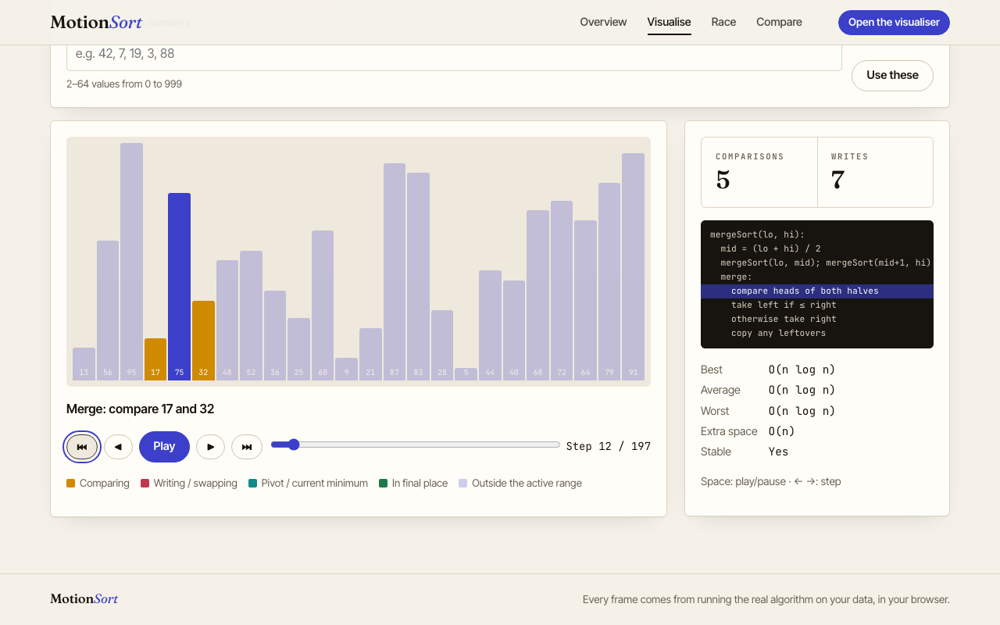
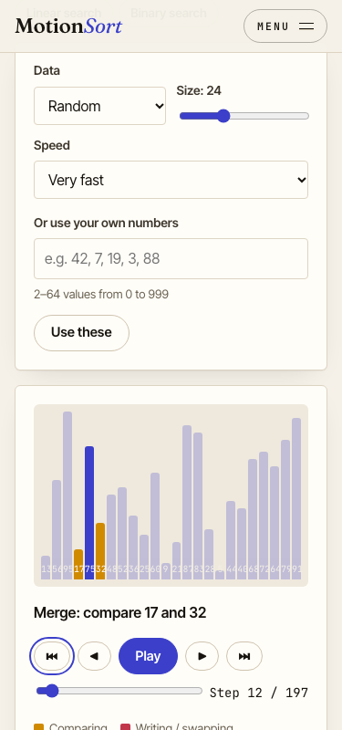

# Motion Sort

An algorithm visualiser: bubble, insertion, selection, merge, quick and heap sort plus linear and binary search, each run on real data and recorded comparison by comparison. Step through them with synced pseudocode and live counters, race two side by side, and compare measured comparison counts across input shapes.

**Live demo:** [https://motion-sort.vercel.app/](https://motion-sort.vercel.app/) — runs entirely in your browser.


| Visualiser | Mobile |
| --- | --- |
|  |  |

## Run it

```bash
npm install
npm run dev        # http://localhost:5222
npm test
npm run build
npm run test:e2e   # Playwright smoke test (npm run e2e:install once if Chromium is missing)
```

## Main workflow

1. **Visualise** → pick an algorithm, data shape (random, nearly sorted, reversed, already sorted, few unique values), size 5–64 and speed — or type your own numbers.
2. Play, pause, step forward and back, jump to the start or end, or scrub. A sentence describes each step; the running line of pseudocode is highlighted; comparisons and writes update live. **Space** plays/pauses and **← →** step.
3. Searches let you choose the target (including one that isn’t there); binary search sorts the list first and shades the shrinking range.
4. **Race** → two sorting algorithms on the same data, advancing one recorded step per tick, with the winner announced.
5. **Compare** → comparison counts measured for every algorithm on every data shape (n = 16, 32 or 64), next to the textbook best, average and worst cases.

## Rules

- Frames come from instrumented implementations: every comparison and array write is recorded, so counts are exact for these implementations.
- Bubble sort stops early after a pass with no swaps; quicksort uses the last element as pivot (Lomuto), so already-sorted input is its worst case.
- Merge sort counts a write for each element copied back during a merge; swaps count as two writes.
- Custom input: 2–64 numbers from 0 to 999.

## Design

Shared editorial system: Fraunces display type, Inter Tight interface text, mono counters and pseudocode, bar states colour-coded with a legend and described in text, a compact ink hero running a real quicksort, and a warm paper workspace. The hero animation and bar transitions stop under `prefers-reduced-motion`.

## Tests

- `src/lib/algorithms.test.ts` — every sort produces the sorted array and marks every index; empty, single and duplicate inputs; early exit and textbook comparison counts; monotonic counters; linear and binary search; preset inputs; custom input validation.
- `src/App.test.tsx` — stepping with buttons and keys, auto-play with fake timers, custom numbers, binary search for a missing value, racing and the comparison table.
- `e2e/smoke.spec.ts` — landing, play merge sort to completion, keyboard stepping, reload persistence of settings, race and compare, plus 375px layout checks.

## Limitations

- Up to 64 values so bars stay readable; very large inputs aren’t animated.
- Counts reflect these specific implementations (for example the Lomuto partition), not every variant.

## Future improvements

- Shell sort, radix sort and a tree view for heap sort; exporting a run as a GIF.

## Licence

MIT — see [LICENSE](LICENSE).
